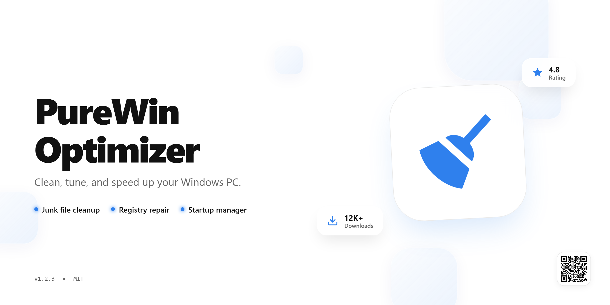

# PureWin Optimizer: One-Click Privacy & Cleanup Tool for Windows 10 & 11

### 💻 PowerShell Installer

   

---

PureWin Optimizer is a portable Windows 10/11 utility that consolidates system tuning, privacy hardening, and cleanup into a single, dependency-free executable. It reads live system state, classifies 45 Windows services by safety tier, and reverses every applied change through snapshot-based rollback. Built-in modules cover telemetry and DiagTrack suppression, Copilot and Recall deactivation, preinstalled package removal with verified per-row status, DNS management with true DHCP restoration, and winget-driven software updates. The interface is fully localized in Turkish, requires no installation, and the source is distributed under the MIT license for open inspection and contribution.

## ✅ Requirements

- **OS:** Windows 10 / 11
- **Shell:** PowerShell 5.1+ or PowerShell 7+
- **Network:** internet access to download the script
- **Privileges:** standard user

## Features

**Tek Tıkla Optimizasyon:** Sistem ayarlarını canlı olarak okuyup uygulama; seçilen optimizasyon profilleri tek bir eylemle uygulanır ve sonuçlar anında doğrulanır.
- **Gizlilik ve Telemetri Kontrolü:** DiagTrack, hata raporlama servisi ve 17 zamanlanmış telemetri görevi devre dışı bırakılabilir; her değişiklik snapshot ile izlenir.
- **Copilot ve Recall Yönetimi:** Windows'un yapay zekâ izleyicileri ve ekran geçmişi kaydı kapatılarak yerel gizlilik güçlendirilir.
- **Servis Sınıflandırması:** 45 Windows servisi "Güvenli / İsteğe Bağlı" olarak etiketlenir; gereksiz olanlar güvenle devre dışı bırakılır.
- **Önyüklü Uygulama Kaldırıcı:** Gereksiz önyüklü paketler canlı ilerleme kartı, satır durum rozetleri ve nihai doğrulama ile kaldırılır.
- **Görsel Hız Ayarları:** Animasyon, şeffaflık ve görsel efektler kapatılarak arayüz akıcılığı artırılır.
- **Oyun ve Performans Modu:** Oyun modu, GPU planlama (HAGS) ve ilgili performans ayarları tek yerden yönetilir.
- **Arama ve Dizin Kontrolü:** Arka plan disk indeksleme isteğe bağlı olarak kapatılabilir.
- **Sistem Temizliği:** Geçici dosyalar ve paket artıkları derinlemesine temizlenir.
- **Canlı Sağlık Raporu:** Sistem durumu puanlanır ve eksikler tek bakışta görüntülenir.
- **Tweak Denetimi:** Güncelleme sonrası tweak durumları salt okunur modda denetlenir.
- **Ağ ve DNS Merkezi:** IPv4 DNS otomatik (DHCP) veya statik olarak yönetilir; önbellek temizlenir ve değişiklikler geri alınır.
- **Yazılım Güncelleyici:** winget ile yüklü uygulamalar taranır, güncellemeler listelenir ve uygulanır.
- **Başlangıç Uygulamaları:** Başlangıçta açılan uygulamalar etki dereceleriyle gösterilir; tek tıkla açılıp kapatılır.
- **Geri Alma Desteği:** Uygulama üzerinden yapılan tüm tweak'ler snapshot ile geri alınabilir.
- **Taşınabilir Yapı:** Kurulum gerektirmez; tek dosya olarak çalışır ve Türkçe arayüz sunar.

## How It Works

PureWin Optimizer operates on a snapshot-based architecture that reads live system state before applying any modification, ensuring every action is traceable and reversible. The application runs as a portable executable with elevated privileges, requiring no installation or background service. On launch, it enumerates the relevant registry hives, service configurations, scheduled tasks, and installed package inventories to build a current baseline.

Each optimization module is isolated and state-aware. When a tweak is applied, PureWin records the prior value, service state, or package registration into a snapshot ledger. This ledger powers the built-in rollback system: reverting a change restores the exact original configuration rather than applying a generic default. Modules that touch registry values verify key existence first, so absent values are removed on rollback instead of being overwritten with assumed defaults.

The privacy and telemetry module targets diagnostic tracking services, error reporting endpoints, and scheduled telemetry tasks, disabling them at the service and task level while preserving Windows-managed COM and StateRepository entries for system integrity. The service optimizer classifies each candidate as safe or optional, applying changes only to those flagged as non-essential and re-querying service status afterward to confirm the resulting state.

The bloatware removal pipeline executes staged operations: queue, removal, verification, and final confirmation. A live progress card reports the package currently being processed, remaining and completed counts, and elapsed time, while per-row status badges reflect each stage. A final system scan validates removal results before success is displayed, so a service-reported success is never treated as final without post-removal verification.

Network and DNS management reads the current adapter configuration, supports automatic and static IPv4 DNS modes, flushes the resolver cache, and restores DHCP assignment on rollback with multi-attempt verification. The visual effects and performance modules adjust animation, transparency, and GPU scheduling parameters, while the search module optionally disables background disk indexing.

A read-only tweak audit re-checks applied settings after Windows updates, reporting drift without modifying state. The live health report aggregates system status into a score with per-category findings. Software updates are enumerated through the system package manager, listed for review, and applied on demand. Startup entries are displayed with impact ratings and toggled through a hardened event sequence. All operations remain confined to user-authorized system settings, and every applied change stays available for reversal through the snapshot ledger.

## Compatibility

PureWin Optimizer is engineered exclusively for Windows 10 and Windows 11 on the x64 architecture, and operates as a portable, self-contained executable that requires no installation and leaves no residual footprint on the host system. The application reads live system state directly from the registry, service control manager, and scheduled task library, which allows every detected configuration to be verified against the actual operating system rather than a cached assumption. Administrative privileges are mandatory: the optimizer must be launched with elevated rights to modify system services, telemetry tasks, DNS settings, and startup entries, and the interface will prompt for elevation on launch if the current token is insufficient.

The application targets the desktop Windows servicing model, meaning it accounts for cumulative update behavior and feature upgrades; the included Tweak Kontrol module performs read-only verification of applied settings after a Windows update, so any configuration reverted by the OS can be identified and reapplied. Windows components managed directly by the platform — including COM registrations, StateRepository entries, and AppxAllUserStore/Deprovisioned records — are intentionally excluded from modification, ensuring that system integrity checks and servicing operations remain unaffected. DNS management operates across all active IPv4 adapters and supports both DHCP-derived and static configurations, with cache flushing and rollback handled at the adapter level. Startup application enumeration reads from both the registry Run keys and the startup folder, reporting per-entry impact ratings without altering unsigned or system-critical entries.

Because PureWin Optimizer runs as a standalone binary, it has no runtime dependency on external frameworks in its portable distribution and can be executed from removable media or a network share with the appropriate permissions. The framework-dependent build variant is available for environments where a shared.NET runtime is already provisioned. All changes applied through the application are captured in snapshots, and the rollback subsystem restores prior values with fidelity — including the removal of registry values that did not exist before modification, rather than writing default placeholders. The Turkish-language interface is bundled and requires no additional language packs. The optimizer is compatible with both standard and high-DPI display configurations and honors the system accessibility settings for keyboard navigation throughout its windows.

## FAQ

**PureWin yönetici yetkisi gerektiriyor mu?**
Evet. Sistem ayarları, servisler, registry anahtarları ve önyüklü uygulamalar üzerinde değişiklik yapıldığı için uygulamanın yönetici olarak çalıştırılması gerekir. Yönetici yetkisi olmadan tweak'ler uygulanamaz ve doğrulama adımları tamamlanamaz.

**Kurulum gerekiyor mu, taşınabilir mi?**
PureWin kurulum gerektirmez. Portable (self-contained) veya Lite (framework-dependent) tek dosya derlemelerinden biriyle doğrudan çalıştırılabilir. Bu sayede sistemde kalıcı bileşen bırakmadan kullanılabilir.

**Yapılan değişiklikler geri alınabilir mi?**
Evet. Uygulama üzerinden yapılan tweak'ler snapshot mekanizmasıyla kaydedilir ve "Geri Al" işleviyle önceki duruma döndürülebilir. DNS değişiklikleri DHCP'ye geri döner; Game Mode gibi ayarlarda orijinal registry değeri yoksa değer tamamen silinir, sıfır veya bir yazılmaz.

**Bloatware kaldırma işlemi doğrulanıyor mu?**
Evet. Kaldırma servisi başarılı dönse bile satır durum rozetleri (`Sırada`, `Kaldırılıyor`, `Doğrulanıyor`, `Kaldırıldı`, `Başarısız`, `Doğrulanamadı`) canlı olarak güncellenir. Yeşil rozet yalnızca nihai sistem taramasından sonra gösterilir. Kalan, başarılı ve başarısız paket sayıları ile geçen süre ilerleme kartında raporlanır.

**Hangi Windows sürümleri destekleniyor?**
Windows 10 ve Windows 11 (x64) desteklenir. Uygulama, sistem ayarlarını canlı olarak okur ve değişiklikleri izler; böylece tweak durumları güncelleme sonrasında salt okunur denetimle doğrulanabilir.

**Tweak Kontrol ne işe yarar?**
Windows güncellemeleri bazı ayarları sessizce sıfırlayabilir. Tweak Kontrol, uygulanan tweak'lerin güncel durumunu salt okunur biçimde denetler ve hangi ayarların yeniden uygulanması gerektiğini gösterir. Hiçbir değişikliği otomatik olarak zorla uygulamaz.

**DNS ayarları nasıl yönetiliyor?**
Ağ & DNS Merkezi, IPv4 DNS yapılandırmasını otomatik (DHCP) veya statik olarak yönetir, DNS önbelleğini temizler ve yapılan değişiklikleri geri alma seçeneği sunar. Geri alma işlemi DHCP'ye gerçekten döner ve doğrulama birden fazla kez denenir.

**Yazılım Güncelleyici hangi kaynağı kullanıyor?**
Yazılım Güncelleyici, yüklü uygulamaları sistem paket yöneticisi üzerinden tarar, mevcut güncellemeleri listeler ve tek tıkla uygular. Güncelleme bulunmadığında "Hepsi Güncel / Güncelleme Yok" durumu gösterilir.

**Hangi kayıtlar güvenlik nedeniyle korunuyor?**
Windows tarafından yönetilen COM kayıtları, StateRepository girdileri ve AppxAllUserStore/Deprovisioned anahtarları güvenlik gerekçesiyle değiştirilmez. Bloatware kaldırma sırasında HKCU altındaki TileProperties, BackgroundAccessApplications, URL ilişkilendirmeleri ve PolicyCache ile HKLM altındaki uygulamaya özel CapabilityAccessManager izinleri temizlenir; korunan sistem kayıtlarına dokunulmaz.

**Uygulama açık kaynak mı, lisansı nedir?**
PureWin, MIT lisansı altında açık kaynak olarak sunulur. Kaynak kod incelenebilir, değiştirilebilir ve lisans koşullarına uygun biçimde yeniden dağıtılabilir. Arayüz Türkçe olarak hazırlanmıştır ve teknik terimler özgün halleriyle korunur.

**Kullanmadan önce ne önerilir?**
Uygulama sistem ayarlarını değiştirdiği için kullanım öncesinde bir geri yükleme noktası oluşturulması önerilir. Uygulama üzerinden yapılan tweak'ler snapshot ile geri alınabilse de sistem düzeyinde ek bir güvence katmanı bulundurmak yararlıdır.

## Disclaimer

PureWin Optimizer modifies core Windows configuration surfaces, including registry keys, scheduled tasks, service startup types, and network adapter DNS settings. These operations are executed with the privileges granted to the process; administrative elevation is required for the majority of them.

All tweaks applied through the application are captured in a snapshot prior to execution. The rollback subsystem restores captured values on demand, and entries that did not exist originally are removed rather than overwritten with placeholder defaults. Windows-managed records under COM, StateRepository, and AppxAllUserStore/Deprovisioned are intentionally excluded from modification.

The bundled software updater relies on the winget package manager present on the host system; update resolution and package integrity are governed by that component and the configured sources.

PureWin Optimizer is provided under the MIT License on an "as is" basis, without warranty of any kind, express or implied. System state varies across hardware, build versions, and existing configurations; validation in a controlled environment and creation of a restore point before applying changes is recommended. Responsibility for operational use rests with the operator.

## License

PureWin Optimizer is distributed under the MIT License, a permissive and well-established open-source license approved by the Open Source Initiative. The license grants every recipient the irrevocable right to use, copy, modify, merge, publish, distribute, sublicense, and sell copies of the software, subject only to the inclusion of the original copyright notice and this permission notice in all copies or substantial portions of the software. In practical terms, this means you may integrate PureWin Optimizer into internal tooling, redistribute it alongside commercial products, or fork the codebase for derivative works without seeking additional authorization or paying royalties of any kind.

The software is provided strictly on an "as is" basis, without warranty of any kind, whether express, implied, or statutory, including but not limited to the implied warranties of merchantability, fitness for a particular purpose, and non-infringement. The authors and copyright holders accept no liability for any claim, damages, or other obligation arising from the use of the software, whether in an action of contract, tort, or otherwise. Because PureWin Optimizer modifies system-level Windows configuration—registry keys, scheduled tasks, services, and network settings—deployment in production or managed environments should be preceded by standard change-management controls such as restore points and staged rollouts.

The complete license text, including the exact copyright attribution and the full grant and liability clauses, is provided in the LICENSE file at the root of the PureWin Optimizer source tree. That file constitutes the authoritative legal terms; the summary above is provided for orientation only and does not modify or supersede the license itself. Redistributors are expected to preserve the LICENSE file unmodified alongside any distributed builds, and contributors submitting changes do so under the same MIT terms.